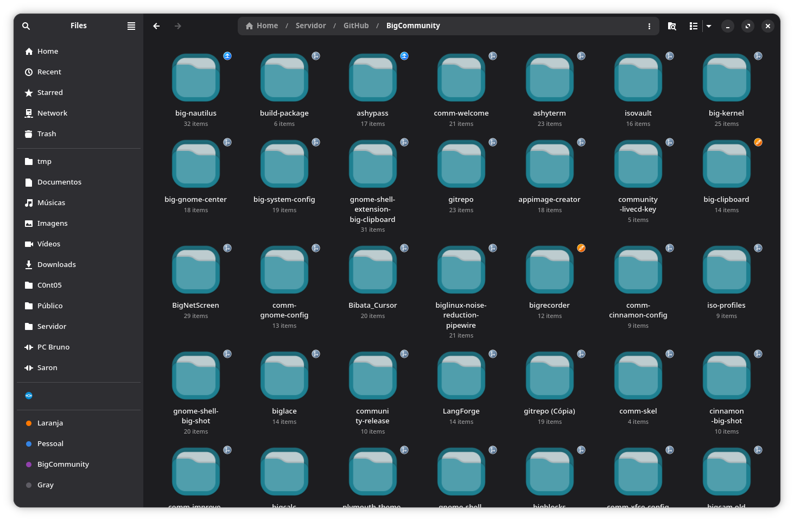
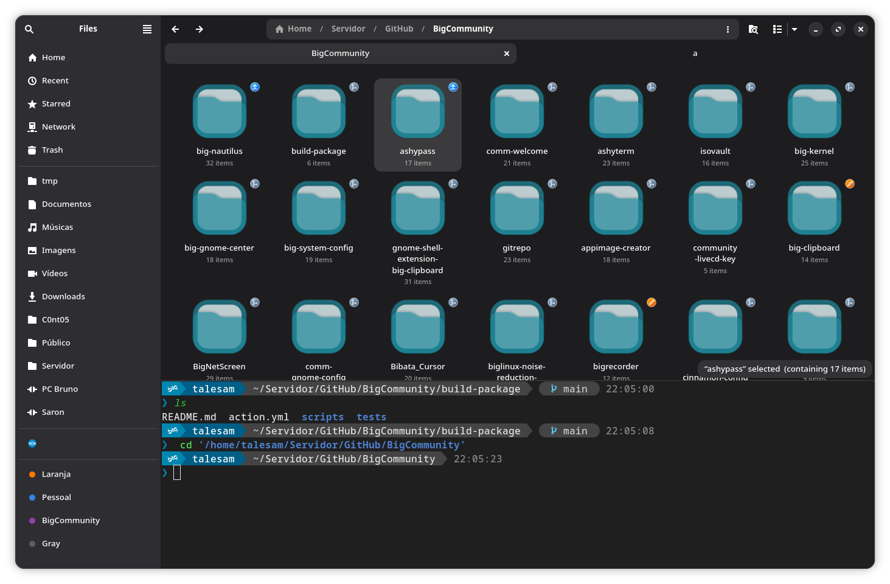
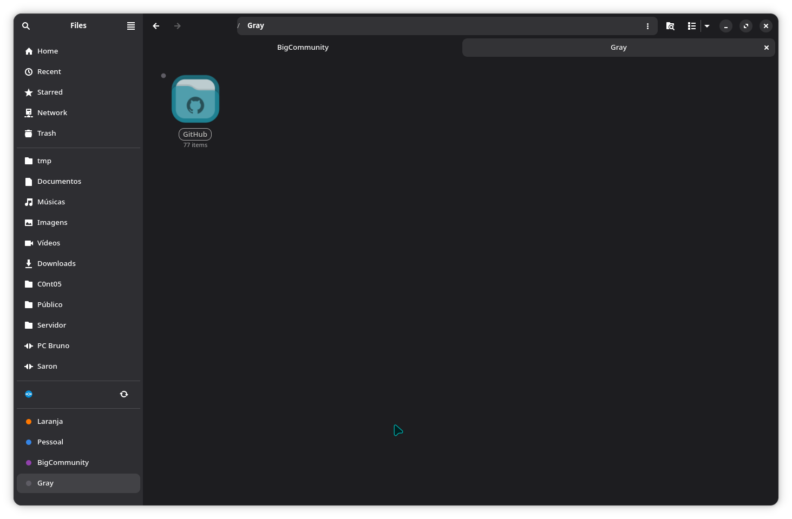

# big-nautilus

A file manager for [BigLinux](https://www.biglinux.com.br/) and
[BigCommunity](https://communitybig.org/), built on
[GNOME Files](https://gitlab.gnome.org/GNOME/nautilus) with an embedded
terminal, colour tags, and an optional index-backed search that answers in
under a millisecond.

Tracks upstream GNOME Files closely — currently **50.4** — so everything you
already know about Files still applies. The additions sit alongside it rather
than replacing it.



---

## Features

### Embedded terminal

A real terminal pane inside the file manager window, backed by VTE — the same
widget GNOME Terminal and Console use. Press <kbd>F4</kbd> to show or hide it.

It can follow you around, in either direction:

| Mode | Behaviour |
|---|---|
| `both` | Browsing changes the terminal's directory, and `cd` moves the view |
| `fm-to-term` | Browsing changes the terminal's directory |
| `term-to-fm` | `cd` in the terminal moves the view |
| `none` | The two stay independent |

Opening an `sftp://` location can connect over SSH automatically and keep the
same directory synchronisation on the remote side. It is off by default; turn
it on from the terminal's context menu.

Following never gets in the way of what the terminal is doing. The `cd` is
only typed when the shell is at its prompt: with an editor, a REPL or a
password prompt in the foreground it waits until the shell is back. Browsing
to or away from a server does not replace a session that is running a
command either; the switch happens when the command ends, or at once if you
ask for it from the context menu.

While the keyboard is in the terminal, the keys a terminal needs go to the
terminal: <kbd>Ctrl</kbd> + <kbd>Z</kbd> suspends the job rather than undoing
a file operation, <kbd>Ctrl</kbd> + <kbd>W</kbd> erases a word rather than
closing the tab, and <kbd>F9</kbd> and <kbd>F10</kbd> reach programs like
`htop` and `mc`.

Files and text dropped on the terminal are pasted at the prompt, quoted and
never executed.

The pane is resizable, its size is remembered per session, and the font,
size and colour scheme are configurable.



### Colour tags

Mark a folder or file with one of eight colours. Tagged items get a coloured
dot in the corner of the icon and an outlined badge around the name — visible
at a glance without turning the view into a colour chart.

Tags can be applied from the context menu or with <kbd>Ctrl</kbd> +
<kbd>Alt</kbd> + <kbd>1</kbd> … <kbd>8</kbd>, and every way of applying one is
undoable with <kbd>Ctrl</kbd> + <kbd>Z</kbd>.

Each colour in use appears in the sidebar as a place you can open, gathering
every file carrying that colour regardless of where it lives. Drag files onto
a colour there to tag them.

Colours can be renamed, so "Orange" becomes "Mobile" or whatever the tag is
actually for. The dot still carries the colour, so the label is free to say
something useful.



Tags follow files through renames and moves — a folder takes the tags of
everything inside it along — and come back with a file restored from the
trash. They are dropped when a file is deleted, and stored in `tags.conf`
under your data directory.

Deleting a tagged file outside big-nautilus leaves its tag behind. Those are
cleared out a minute after startup, but only when the file is certain to be
gone: a file on a disk that is unplugged, or on a share that is not mounted,
keeps its tag.

### Fast search

When the [BigSearch](https://github.com/biglinux/bigsearch) daemon is
running, big-nautilus queries its Tantivy index instead of walking the
filesystem. Measured on one machine, searching the same tree:

| Engine | Median latency |
|---|---|
| BigSearch | **0.54 ms** |
| LocalSearch (Tracker) | 43–200 ms |
| Directory traversal | seconds |

The location you are searching in, and any type or modification-date filter,
are pushed into the index rather than applied afterwards. When the search is
set to look inside files, the daemon does that too, from the same index.

A search is as slow as its slowest engine, so when the daemon answers it has
the search to itself: neither the directory walk nor LocalSearch runs next to
it. Measured on one home folder, for a single letter typed, LocalSearch took
11 seconds to answer and the walk matched 66,926 entries; the daemon answers
in 3 to 80 ms. The other engines only step in where the daemon cannot answer:

- when it fails, or says it does not index the folder searched, or has not
  finished its first pass over the disk;
- in the trash, recent files, tag folders and remote locations, when
  searching the current folder only, and when filtering by access or
  creation date.

Two things the index leaves out are therefore not found below the current
folder while the daemon is answering: hidden files, and by default whatever a
`.gitignore` excludes (`respect_gitignore` in the daemon's `config.toml`).
Files in the folder you are looking at are always matched.

Whatever engine answers, the window stays responsive. A search hands the view
at most 1000 results, the first 60 at once and the rest when the typing
pauses, because every result is a row the view builds and, one letter later,
throws away.

The daemon is entirely optional. When it is not running, search falls back to
the engines GNOME Files ships with, and nothing changes.

---

## Installing

### On BigLinux / BigCommunity

```sh
sudo pacman -S big-nautilus
```

It `provides` and `replaces` `nautilus`, so it takes the place of the stock
file manager. If you are coming from the older `nautilus-with-terminal`
package, it is replaced in place.

### Building from source

Dependencies match GNOME Files 50, plus VTE for the terminal and json-glib
for the search client:

```sh
meson setup builddir
meson compile -C builddir
meson test -C builddir
sudo meson install -C builddir
```

To run a development copy side by side with the installed one, without
installing:

```sh
meson setup builddir -Dprofile=Devel
meson compile -C builddir
GSETTINGS_SCHEMA_DIR=$PWD/builddir/data ./builddir/src/nautilus
```

### Building the package

The recipe lives in `pkgbuild/`:

```sh
cd pkgbuild && makepkg -si
```

---

## Configuration

Settings live under the standard GSettings schema and can be changed from the
terminal's context menu or on the command line:

```sh
# Terminal
gsettings set org.gnome.nautilus.terminal local-sync-mode 'both'
gsettings set org.gnome.nautilus.terminal ssh-auto-connect-mode 'off'
gsettings set org.gnome.nautilus.terminal font-size 11
gsettings set org.gnome.nautilus.terminal color-scheme 'dark'
```

| Key | Values | Default |
|---|---|---|
| `local-sync-mode` | `none`, `fm-to-term`, `term-to-fm`, `both` | `both` |
| `ssh-auto-connect-mode` | `off`, `sync-none`, `sync-fm-to-term`, `sync-term-to-fm`, `sync-both` | `off` |
| `visible` | whether the pane starts open | `false` |
| `font`, `font-size`, `color-scheme` | terminal appearance | system |

---

## Keyboard shortcuts

Everything GNOME Files binds, plus:

| Shortcut | Action |
|---|---|
| <kbd>F4</kbd> | Show or hide the terminal |
| <kbd>Ctrl</kbd> + <kbd>Alt</kbd> + <kbd>1</kbd> … <kbd>8</kbd> | Apply a colour tag to the selection |
| <kbd>Ctrl</kbd> + <kbd>Alt</kbd> + <kbd>0</kbd> | Remove the colour tag |
| <kbd>Ctrl</kbd> + <kbd>Z</kbd> | Undo, including tagging |

---

## Relationship to GNOME Files

This is a fork, not a rebuild. The vast majority of the code is GNOME Files,
written by the GNOME project, and upstream releases are merged in as they
come out.

**Please report bugs here, not to GNOME.** If you can reproduce a problem in
stock GNOME Files, it belongs
[upstream](https://gitlab.gnome.org/GNOME/nautilus/issues); anything
involving the terminal, the colour tags or the search integration is ours.

The application ID, the GSettings schema and the extension directory keep
their upstream names on purpose, so Nautilus extensions, the file chooser
portal and the GNOME Shell search provider all keep working.

Extensions written for GNOME Files — including Python ones via
`nautilus-python` — load unchanged.

---

## Contributing

Issues and merge requests are welcome. For code, the repository follows
upstream GNOME Files conventions: C11, GNOME coding style, and commit
messages that explain *why* a change was made rather than restating the
diff.

Translations for the fork's own strings live in two gettext domains of their
own, `nautilus-terminal` and `nautilus-tags`, kept separate from the
upstream catalogue so that merging a new GNOME release cannot overwrite
them. Both currently cover 33 languages.

Run the test suite before sending a change:

```sh
meson test -C builddir
```

---

## License

GPL-3.0-or-later, the same as GNOME Files. See [LICENSE](LICENSE).

GNOME Files is © the GNOME Project. The additions described above are
© BigCommunity.
